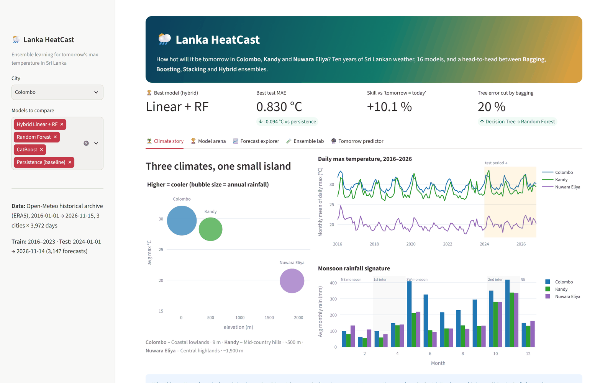
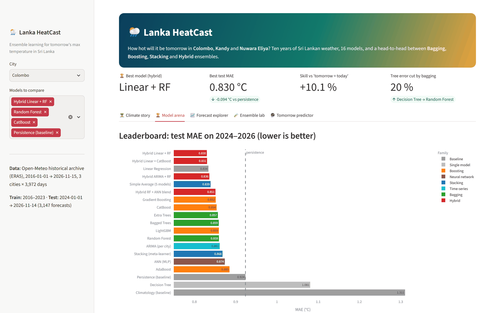
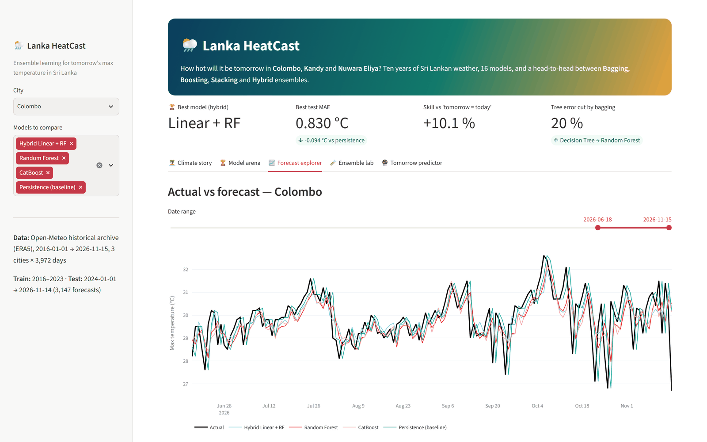
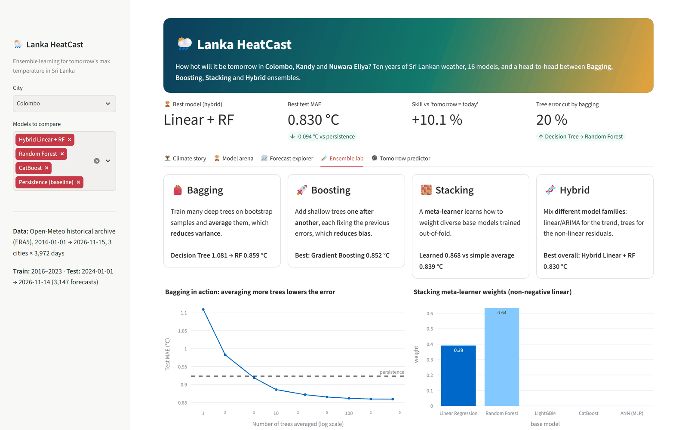
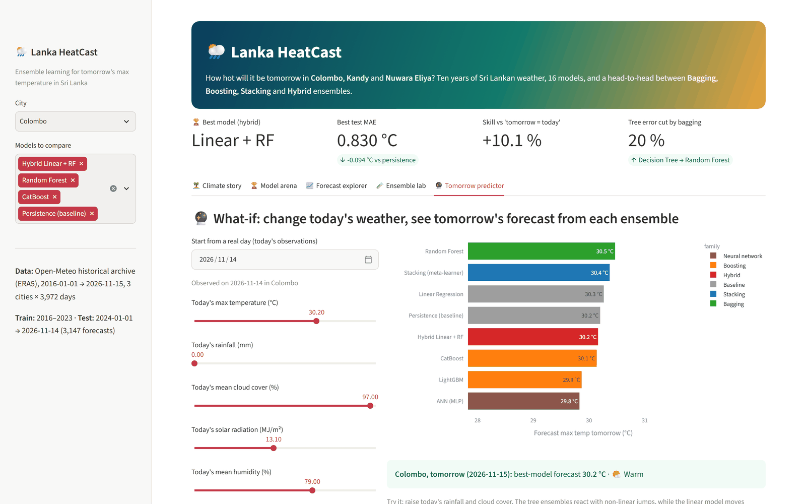

# 🌦️ Lanka HeatCast: Ensemble Learning Dashboard

Forecasting **tomorrow's maximum temperature** for **Colombo, Kandy and Nuwara Eliya** with
**Bagging, Boosting, Stacking and Hybrid** ensembles, using 11 years of real Sri Lankan weather data.

[](https://lanka-heatcast-3i5bt6ur5i9gdumsysouf3.streamlit.app/)

### 🔗 Live app: **<https://lanka-heatcast-3i5bt6ur5i9gdumsysouf3.streamlit.app/>**

| | |
|---|---|
| **Data** | Open-Meteo Historical Weather API (ERA5 reanalysis), daily, 2016-01-01 → 2026-11-15, 3 cities × 3,972 days, 9 variables (`data/`) |
| **Target** | Next-day maximum 2 m temperature (°C) |
| **Split** | Train 2016–2023 · Test 2024-01-01 → 2026-11-14 (chronological, 3,147 forecasts) |
| **Bagging** | Bagged Trees, Random Forest, Extra Trees |
| **Boosting** | AdaBoost, Gradient Boosting, LightGBM, CatBoost |
| **Stacking** | Linear + RF + LightGBM + CatBoost + ANN → non-negative linear meta-learner (time-ordered out-of-fold), plus simple average |
| **Hybrids** | ARIMA + Random Forest (Zhang residual hybrid) · RF + ANN blend · Linear Regression + RF/CatBoost residual |
| **Best model** | Hybrid Linear + RF, MAE **0.830 °C**, R² 0.948, +10.1 % skill vs persistence |

## Screenshots

### 🏝️ Climate story
Three cities, three climates: elevation vs mean max temperature, the 2016–2026 daily series with the
test period highlighted, and the twin-monsoon rainfall signature.



### 🏆 Model arena
All 16 models ranked by test MAE and coloured by family, against the persistence baseline.



### 📈 Forecast explorer
Predicted vs actual over the test period, residual behaviour, and per-city / per-season error breakdowns.



### 🧪 Ensemble lab
How bagging drives variance down as estimators are added, plus feature importances and meta-learner weights.



### 🔮 Tomorrow predictor
What-if sliders: change today's observations and watch every ensemble re-forecast tomorrow's maximum.



## Files
* `Ensemble_Weather_SriLanka.ipynb`: the full, executed pipeline (EDA → features → models → evaluation → interpretation). Running it re-creates `artifacts/`.
* `app.py`: Streamlit dashboard with 5 tabs: Climate story · Model arena · Forecast explorer · Ensemble lab · Tomorrow predictor (what-if).
* `artifacts/`: leaderboard, predictions, feature importances and trained models used by the dashboard.
* `data/sri_lanka_weather_2016_2026.csv`: the dataset. If it is missing, the notebook downloads it again from Open-Meteo.

## Run locally
```bash
pip install -r requirements.txt
jupyter notebook Ensemble_Weather_SriLanka.ipynb   # optional: re-train (≈5 min)
streamlit run app.py
```

## Deployment

The app is deployed on **Streamlit Community Cloud** from the `main` branch of this repository:

**<https://lanka-heatcast-3i5bt6ur5i9gdumsysouf3.streamlit.app/>**

Streamlit Cloud watches the connected branch, so **every push to `main` redeploys the app automatically** —
no manual step. A rebuild takes roughly 1–3 minutes (longer if `requirements.txt` changed, since the
dependencies are reinstalled). The app also sleeps after a period of inactivity and wakes on the next visit.

To deploy your own copy:

1. Fork or push this folder to a public GitHub repository.
2. Go to https://share.streamlit.io, choose **New app**, select the repo, branch `main` and file `app.py`,
   and set Python to **3.13** under *Advanced settings*.
3. Deploy.

*Weather data by [Open-Meteo.com](https://open-meteo.com/) (CC BY 4.0), based on ERA5 reanalysis (Copernicus Climate Change Service).*
